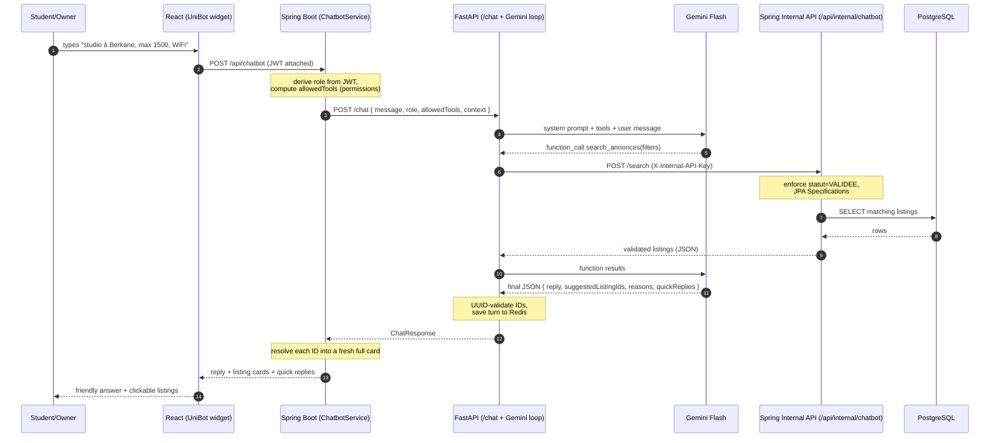

# UniHome Chatbot — Technical Architecture & Build Documentation

> **Audience**: developers, jury, and future maintainers.
> **Scope**: how UniBot (the UniHome assistant) is built, which technologies are used, how a message flows end-to-end, and what each component is responsible for.
> **This document is self-contained** — it is the single source of truth for the chatbot and is written directly from the built source code. You do not need to read any other file to understand the system.

---

## 1. Executive summary

UniBot is a **retrieval-grounded conversational assistant** for a Moroccan student-housing platform. Instead of inventing answers, it queries the **real UniHome database on demand** using Google **Gemini function-calling**, then replies in structured JSON that the React UI turns into clickable listing cards.

The system is split across **four layers**, each with a single, clear responsibility:

| Layer                 | Technology                                | Responsibility                                                                                                                 |
| --------------------- | ----------------------------------------- | ------------------------------------------------------------------------------------------------------------------------------ |
| **Frontend**          | React + Vite + Axios                      | Chat UI, sends the user message, renders the reply and listing cards                                                           |
| **Backend (Spring)**  | Spring Boot + Spring Security + WebClient | Public chat endpoint, identifies the user, computes permissions, calls the AI service, resolves listing IDs back to full cards |
| **AI service**        | FastAPI + google-generativeai + httpx     | Owns the Gemini conversation, runs the tool-calling loop, manages short-term memory                                            |
| **Internal data API** | Spring Boot (`/api/internal/**`)          | Read-only, secret-protected endpoints the AI calls to search/inspect listings                                                  |

A key design rule: **the AI service never touches the database or builds SQL.** It can only call typed Spring Boot endpoints that are protected by a shared-secret filter. This keeps the security boundary inside the JVM.

---

## 2. Technology stack

### 2.1 Frontend

- **React** (functional components + hooks) for the chat page and the floating UniBot widget.
- **Vite** dev server with hot-module reloading.
- **Axios** instance ([frontend/src/api/axios.js](../frontend/src/api/axios.js)) that automatically attaches the JWT to every request.

### 2.2 Backend — Spring Boot

- **Spring Web** for the REST controllers.
- **Spring Security** + a custom `JwtFilter` to know _who_ is talking (student / owner / admin / anonymous).
- **Spring WebFlux `WebClient`** to call the Python AI service asynchronously with a timeout.
- **JPA / Hibernate** + **JPA Specifications** for the dynamic listing search.

### 2.3 AI service — FastAPI (Python)

- **FastAPI** + **Uvicorn** ASGI server.
- **google-generativeai** SDK → **Gemini Flash** model (function-calling + multimodal).
- **httpx** async client to call the Spring internal API.
- **Pydantic** for strict request/response validation.
- **Redis** (`redis.asyncio`) for short-lived conversation memory (optional, degrades gracefully).
- **tenacity** for retry/backoff (used by the scoring sibling).

### 2.4 Infrastructure

- **Docker Compose** ([docker-compose.yml](../docker-compose.yml)) runs the services on one network. The containers relevant to the chatbot are:
  - `unihome-db` — PostgreSQL
  - `unihome-redis` — Redis 7 (alpine), conversation memory
  - `unihome-ai-service` — FastAPI (the AI service)
  - `api` — Spring Boot
  - `frontend` — React + Vite
- Services talk by **service/container name** on the Docker network:
  - The AI service reaches Spring at `BACKEND_INTERNAL_URL` (default `http://api:8080`).
  - The AI service reaches Redis at `REDIS_URL` = `redis://redis:6379/0`.
  - Spring reaches the AI service at `python.service.url` (the `PYTHON_SERVICE_URL` env var; `http://localhost:8000` locally, the `ai-service` container in Docker).

---

## 3. The big picture — end-to-end flow

```
┌──────────┐   1. POST /api/chatbot      ┌─────────────────────┐
│  React   │ ─────────────────────────►  │   Spring Boot       │
│  UniBot  │   { message, sessionId,     │   ChatbotController  │
│  widget  │     currentAnnonceId }      │   + ChatbotService   │
└──────────┘                              └─────────┬───────────┘
     ▲                                              │ 2. resolve role + permissions
     │                                              │    (JWT → STUDENT/OWNER/ADMIN)
     │                                              ▼
     │                                  3. POST /chat (WebClient)
     │                                  { message, role, allowedTools,
     │                                    currentAnnonce, ownerListings }
     │                                              │
     │                                              ▼
     │                                  ┌─────────────────────────┐
     │                                  │   FastAPI  /chat         │
     │                                  │   Gemini tool-loop       │
     │                                  └───────────┬─────────────┘
     │                                              │ 4. Gemini decides: "I must search"
     │                                              ▼
     │                          5. POST /api/internal/chatbot/search
     │                             (X-Internal-API-Key header)
     │                                              │
     │                                  ┌───────────▼─────────────┐
     │                                  │ Spring InternalChatbot   │
     │                                  │ Controller → JPA search  │
     │                                  │ (statut = VALIDEE only)  │
     │                                  └───────────┬─────────────┘
     │                                              │ 6. returns matching DB rows
     │                                              ▼
     │                                  7. FastAPI feeds rows back to Gemini
     │                                              │
     │                                  8. Gemini writes final JSON:
     │                                     { reply, suggestedListingIds,
     │                                       listingReasons, quickReplies }
     │                                              │
     │       9. Spring resolves each ID ◄───────────┘
     │          back to a full listing card
     │          (fresh title/score/photos)
     └──────────────────────────────────────────────
        10. React renders reply + listing cards + quick replies
```

**The one-sentence version**: the browser asks Spring, Spring asks the AI with the user's _permissions_, the AI asks the database through Gemini's tools, and the answer flows back enriched at every step.

The same flow as a sequence diagram:



---

## 4. Layer-by-layer detail

### 4.1 Frontend — the chat client

**Files**: [frontend/src/api/chatbotApi.js](../frontend/src/api/chatbotApi.js) (HTTP client) · [frontend/src/components/chatbot/ChatbotPanel.jsx](../frontend/src/components/chatbot/ChatbotPanel.jsx) (the UI widget)

The client is intentionally tiny. It sends exactly this body (matching the Spring `ChatbotRequestDTO`):

```js
api.post("/api/chatbot", {
  message, // what the user typed
  sessionId, // stable ID per browser session (enables memory)
  currentAnnonceId, // UUID, set when chatting from a listing detail page
  ownerAnnonceId, // UUID, set when an owner asks about a specific listing
  intentHint, // optional UI hint
});
```

- `sessionId` is generated client-side in `ChatbotPanel.jsx` with `crypto.randomUUID()` (with a timestamp+random fallback). It links successive messages into one conversation and becomes the Redis memory key downstream. "New conversation" simply regenerates it.
- `currentAnnonceId` gives the assistant page-context: _"the user is looking at this listing right now."_
- The JWT is added automatically by the Axios interceptor, so the backend always knows the identity.

**The reply** (Spring `ChatbotResponseDTO`) contains:

```json
{
  "reply": "text shown in the chat bubble",
  "sessionId": "echoed back",
  "suggestedListings": [
    /* full listing cards, see below */
  ],
  "quickReplies": ["suggestion 1", "suggestion 2"]
}
```

Each entry in `suggestedListings` is a `ChatbotSuggestedListingDTO`: `{ id, titre, loyer, ville, typeLogement, scoreConfiance, reasons[], route }`. The `route` (e.g. `/annonces/{id}`) is what makes each card directly clickable. The UI renders `reply` as the bubble, `suggestedListings` as cards, and `quickReplies` as suggestion buttons.

---

### 4.2 Backend (Spring) — the public gateway & identity layer

This is the **trust boundary**. The browser is never trusted to declare its own role; Spring derives it from the verified JWT.

**Controller** — [ChatbotController.java](../backend/src/main/java/com/unihome/api/controller/ChatbotController.java)

```java
@RestController
@RequestMapping("/api/chatbot")
public class ChatbotController {
    @PostMapping
    public ResponseEntity<ChatbotResponseDTO> chat(
            @RequestBody ChatbotRequestDTO request,
            Authentication authentication) {       // ← identity injected by Spring Security
        return ResponseEntity.ok(chatbotService.chat(request, authentication));
    }
}
```

**Service** — [ChatbotService.java](../backend/src/main/java/com/unihome/api/service/ChatbotService.java)

This class does four important jobs:

1. **Resolve the role** from the authentication object (`STUDENT`, `PROPRIETAIRE`, `ADMIN`, or `ANONYMOUS`).
2. **Compute permissions** (`allowedTools`) — the assistant only gets capabilities the user is entitled to:
   ```java
   Map.of(
       "canRecommendListings",    true,
       "canDiscussOwnerListings", canDiscussOwnerListings, // only owners, only for their own listings
       "canRevealContacts",       false                    // never expose phone numbers here
   )
   ```
3. **Build the AI request** ([ChatbotAiRequest](../backend/src/main/java/com/unihome/api/dto/ChatbotAiRequest.java)) including the current listing context and, for owners, a private summary of their own listings (so UniBot can explain _"why is my listing pending?"_).
4. **Call the AI service** via `WebClient` with a 60s timeout and a graceful fallback. The `WebClient` base URL is configured once in [WebClientConfig.java](../backend/src/main/java/com/unihome/api/config/WebClientConfig.java) from the `python.service.url` property:
   ```java
   webClient.post().uri("/chat").bodyValue(aiRequest)
       .retrieve().bodyToMono(ChatbotAiResponse.class)
       .timeout(TIMEOUT)
       .onErrorResume(ex -> Mono.just(fallbackResponse(...))) // never 500 to the user
       .block();
   ```

**The enrichment step (important):** Gemini only returns listing **IDs**. Spring then re-loads each ID into a full, fresh card (`buildSuggestedListings`), so the UI always shows current title, score, and photos — even if the AI's tool results were a few seconds stale. Unresolvable IDs are silently dropped, which also acts as a second anti-hallucination guard.

---

### 4.3 AI service (FastAPI) — the brain & the tool-loop

**File**: [ai-service/main.py](../ai-service/main.py) · **Endpoint**: `POST /chat`

This is where the actual intelligence lives. The flow inside `/chat`:

#### Step 1 — Load memory

`_load_chat_history(sessionId)` pulls the recent turns from Redis (key `unihome:chat:{sessionId}`), capped at `CHAT_HISTORY_MAX_MESSAGES`. If Redis is down, it returns an empty history and logs a warning — the chat still works, just statelessly.

#### Step 2 — Build the system prompt + context

Two prompts are combined:

- `CHATBOT_SYSTEM_PROMPT` — the personality and the hard rules (answer only about UniHome, never invent a listing, never reveal contacts/CIN/admin notes, always advise visiting before paying).
- `CHATBOT_TOOL_SYSTEM_PROMPT` — appends the **tool-usage instructions**, including how to translate natural language into filters:
  > "à Casa" → ville · "studio" → typeLogement · "moins de 3000 DH" → prixMax=3000 · "proche ENIAD" → autourUniversiteNom + rayonMetres≈3000 · "sans réfrigérateur" → equipementsExclus

The per-request context (`_chat_context_text`) tells Gemini the user's role, language, permissions, the listing they're currently viewing, and — for owners — their private listings.

#### Step 3 — The three tools Gemini can call

Defined as `FunctionDeclaration`s in [ai-service/main.py](../ai-service/main.py):

| Tool                             | Purpose                                           | Guard                                             |
| -------------------------------- | ------------------------------------------------- | ------------------------------------------------- |
| `search_annonces(filtres)`       | Search **validated** public listings              | Always allowed; results hard-capped               |
| `get_annonce_details(annonceId)` | Full detail of one listing                        | Always allowed                                    |
| `get_owner_listings()`           | The connected owner's own listings (all statuses) | **Refused** unless `canDiscussOwnerListings=true` |

The `search_annonces` tool exposes a typed schema so Gemini fills exactly these (all optional) filters:

| Filter                | Type     | Meaning                                                             |
| --------------------- | -------- | ------------------------------------------------------------------- |
| `ville`               | string   | Moroccan city (case/accent-insensitive)                             |
| `typeLogement`        | enum     | `STUDIO` \| `CHAMBRE` \| `COLOCATION` \| `APPARTEMENT`              |
| `prixMin` / `prixMax` | number   | Rent bounds in MAD                                                  |
| `surfaceMin`          | number   | Minimum surface in m²                                               |
| `chargesIncluses`     | boolean  | Keep only "charges included" listings                               |
| `scoreConfianceMin`   | integer  | Min trust score (use 70 for "reliable")                             |
| `equipementsRequis`   | string[] | Equipment that MUST be present ("avec X")                           |
| `equipementsExclus`   | string[] | Equipment to EXCLUDE ("sans X", "pas de X", "non meublé")           |
| `autourUniversiteNom` | string   | University name for proximity (e.g. `ENIAD`, `ENSIAS`)              |
| `rayonMetres`         | integer  | Search radius around the university (default 3000)                  |
| `limit`               | integer  | Max results (default 10, hard-capped at `CHATBOT_TOOL_MAX_RESULTS`) |

The `equipementsExclus` filter is the reason UniBot correctly handles negations like _"appartement à Berkane sans réfrigérateur"_ — something a prompt-stuffing approach (where all listings are dumped into the prompt) struggles with.

#### Step 4 — The tool-calling loop

`_run_chatbot_tool_loop` is the heart of the system:

```
start_chat(history)  →  send user message
   repeat up to CHATBOT_TOOL_MAX_TURNS (3):
       did Gemini emit a function_call?
          NO  → break (it's ready to answer)
          YES → execute each call against Spring (_dispatch_tool_call)
                feed the JSON results back to Gemini
   extract the final JSON text answer
```

Each tool call is dispatched to a handler (`_call_search_annonces`, `_call_get_annonce_details`, `_call_get_owner_listings`) that performs an **httpx** request to the Spring internal API with the secret header. The owner tool returns a deterministic refusal if the permission flag is off — keeping the LLM honest about scopes regardless of what the user asks.

#### Step 5 — Validate and sanitize the answer

- `_extract_json_object` robustly pulls the JSON out (strips Markdown fences, balances braces).
- The response is validated against the `ChatResponse` Pydantic model.
- **Anti-hallucination**: every `suggestedListingId` is checked against a strict UUID regex; anything that isn't a real UUID returned by a tool is dropped, along with its reasons.

#### Step 6 — Save memory

`_save_chat_turn` appends the user message + assistant reply to Redis with a TTL (`CHAT_HISTORY_TTL_SECONDS`, default 1 hour). No permanent, account-linked chat history is stored — privacy by design.

---

### 4.4 Internal data API (Spring) — the safe database gateway

**Controller**: [InternalChatbotController.java](../backend/src/main/java/com/unihome/api/controller/InternalChatbotController.java) · **Base path**: `/api/internal/chatbot`

Three read-only endpoints back the three Gemini tools:

| Endpoint                        | Backs the tool        | Safety                                                                                                                                                                                                          |
| ------------------------------- | --------------------- | --------------------------------------------------------------------------------------------------------------------------------------------------------------------------------------------------------------- |
| `POST /search`                  | `search_annonces`     | Enforces `statut = VALIDEE`; maps the JSON body ([AnnonceSearchRequest](../backend/src/main/java/com/unihome/api/dto/AnnonceSearchRequest.java)) to **JPA Specifications**, combining only the non-null filters |
| `GET /annonces/{id}`            | `get_annonce_details` | Same projection a public visitor could see                                                                                                                                                                      |
| `GET /owner/{ownerId}/annonces` | (owner flows)         | Called only with the owner's own UUID                                                                                                                                                                           |

The `AnnonceSearchRequest` DTO carries Bean-Validation constraints (`@Size`, `@DecimalMin`, `@Min/@Max`) and a Javadoc-documented rule: **only `statut = VALIDEE` listings are ever returned, regardless of the caller.** All string comparisons are case- and accent-insensitive.

**Why this exists**: the AI service must _not_ run SQL or hold DB credentials. By exposing typed endpoints, all query logic, validation, and the "only show validated listings" rule stay inside the trusted JVM.

**The security filter** — [InternalApiKeyFilter.java](../backend/src/main/java/com/unihome/api/security/InternalApiKeyFilter.java)

Every `/api/internal/**` request must carry the `X-Internal-API-Key` header:

- The secret is read from `unihome.internal.api-key`; **the app refuses to start if it's blank**, so you can never accidentally run with this auth disabled.
- The comparison uses `MessageDigest.isEqual(...)` — a **constant-time** check that prevents timing attacks.
- Any mismatch returns **401** without revealing whether the key was missing or simply wrong.

This is the same secret the FastAPI service sends (`INTERNAL_API_KEY`), so only our AI service can reach these endpoints — never the public internet.

---

## 5. Security & privacy model (why it's trustworthy)

1. **Identity is server-derived.** The browser cannot claim to be an admin; Spring reads the role from the verified JWT.
2. **Capabilities are explicit.** `allowedTools` is computed in Spring and passed down; the AI cannot exceed them (e.g. a student can never trigger `get_owner_listings`).
3. **No SQL in the AI layer.** Gemini's tools map to typed Spring endpoints, not raw queries.
4. **Service-to-service auth.** The internal API is locked behind a constant-time shared-secret filter, fail-closed at startup.
5. **No data invention.** Suggested IDs are UUID-validated and re-resolved against the DB; non-existent IDs vanish.
6. **Sensitive data is never exposed.** The prompt forbids revealing contacts, CIN, justificatifs, or admin notes; `canRevealContacts` is hard-set to `false` for chat.
7. **Ephemeral memory.** Conversations live in Redis with a TTL and a message cap — nothing permanent, nothing account-linked.
8. **Graceful degradation.** If the AI service is unreachable, Spring returns a helpful fallback; if Redis is down, chat continues without memory. The user never sees a 500.

---

## 6. Configuration reference

| Variable                                    | Layer      | Meaning                                                                                                    |
| ------------------------------------------- | ---------- | ---------------------------------------------------------------------------------------------------------- |
| `GEMINI_API_KEY`                            | AI service | Gemini credential (shared with the scoring feature)                                                        |
| `GEMINI_MODEL_NAME`                         | AI service | Primary model (e.g. `gemini-flash-latest`)                                                                 |
| `GEMINI_FALLBACK_MODEL_NAMES`               | AI service | Optional comma-separated fallbacks                                                                         |
| `BACKEND_INTERNAL_URL`                      | AI service | Base URL of Spring (`http://api:8080` in Docker)                                                           |
| `INTERNAL_API_KEY`                          | AI service | Shared secret sent in `X-Internal-API-Key`                                                                 |
| `unihome.internal.api-key`                  | Spring     | Expected secret; app fails to start if blank                                                               |
| `python.service.url` (`PYTHON_SERVICE_URL`) | Spring     | Base URL of the FastAPI AI service (`http://localhost:8000` locally; the `ai-service` container in Docker) |
| `REDIS_URL`                                 | AI service | Conversation memory store (`redis://redis:6379/0` in Docker)                                               |
| `CHAT_HISTORY_TTL_SECONDS`                  | AI service | Memory lifetime (default 3600)                                                                             |
| `CHAT_HISTORY_MAX_MESSAGES`                 | AI service | Max turns kept (default 10)                                                                                |
| `CHATBOT_TOOL_MAX_TURNS`                    | AI service | Max tool round-trips per message (default 3)                                                               |
| `CHATBOT_TOOL_MAX_RESULTS`                  | AI service | Hard cap on search results                                                                                 |
| `CHATBOT_TOOL_TIMEOUT_S`                    | AI service | Timeout for each internal API call                                                                         |

---

## 7. Worked example

**User (logged in as a student, on no particular listing):**

> "je cherche un studio à Berkane proche de l'ENIAD, max 1500 DH, avec WiFi"

1. React → `POST /api/chatbot` with the message + sessionId. JWT attached.
2. Spring resolves role = `STUDENT`, permissions = `{canRecommendListings:true, canDiscussOwnerListings:false, canRevealContacts:false}`.
3. Spring → `POST /chat` on FastAPI with that context.
4. Gemini reads the tool instructions and emits a function call:
   ```json
   search_annonces({
     "ville": "Berkane", "typeLogement": "STUDIO",
     "prixMax": 1500, "equipementsRequis": ["WiFi"],
     "autourUniversiteNom": "ENIAD", "rayonMetres": 3000
   })
   ```
5. FastAPI → `POST /api/internal/chatbot/search` (with the secret header). Spring runs the JPA query filtered to `VALIDEE` and returns the matching rows.
6. FastAPI feeds the rows back; Gemini writes:
   ```json
   {
     "reply": "Voici un studio validé proche de l'ENIAD…",
     "suggestedListingIds": ["fd35b159-…"],
     "listingReasons": {
       "fd35b159-…": ["À ~5 min de l'ENIAD", "1 200 MAD, sous votre budget"]
     },
     "quickReplies": [
       "Voir les détails",
       "Autres studios à Berkane",
       "Comment fonctionne le score ?"
     ]
   }
   ```
7. Spring validates the UUID, re-loads the full card, and returns it to React.
8. The user sees a friendly message plus a real, clickable listing card.

---

## 8. Two grounding strategies: prompt-stuffing vs. function-calling

There are two common ways to keep an LLM answer grounded in real data.

**Prompt-stuffing** is the simplest: load the catalogue (e.g. a small JSON file), **paste every listing into one prompt**, and let the model reply in free text. It is easy to build and great for demonstrating the concept, but it does not scale — the prompt grows with the catalogue, negations ("sans X") are unreliable, and the output is unstructured.

**Function-calling** (the strategy UniBot uses) keeps the catalogue out of the prompt entirely. The model is given typed tools and **asks for exactly the data it needs**, so only the matching rows ever reach it.

| Aspect            | Prompt-stuffing                        | Function-calling (this project)           |
| ----------------- | -------------------------------------- | ----------------------------------------- |
| Listings source   | Static catalogue, dumped in the prompt | Live PostgreSQL, queried on demand        |
| Grounding method  | Everything in the prompt               | **Model asks for data via typed tools**   |
| Scalability       | ~dozens of listings                    | Thousands (only matches reach the model)  |
| Identity / scopes | None                                   | Role-based `allowedTools`                 |
| Output            | Plain text                             | Structured JSON → clickable UI cards      |
| Memory            | In-process list                        | Redis with TTL                            |
| Security          | None                                   | JWT identity + internal-API secret filter |

Same underlying idea — an LLM grounded in your data — but function-calling adds the scalability, scoping, structure, and security a real platform needs.

---

## 9. File map (quick reference)

| Concern                                   | File                                                                                                                                        |
| ----------------------------------------- | ------------------------------------------------------------------------------------------------------------------------------------------- |
| Frontend chat client                      | [frontend/src/api/chatbotApi.js](../frontend/src/api/chatbotApi.js)                                                                         |
| Frontend chat widget (UI)                 | [frontend/src/components/chatbot/ChatbotPanel.jsx](../frontend/src/components/chatbot/ChatbotPanel.jsx)                                     |
| Public chat controller                    | [backend/.../controller/ChatbotController.java](../backend/src/main/java/com/unihome/api/controller/ChatbotController.java)                 |
| Chat orchestration + enrichment           | [backend/.../service/ChatbotService.java](../backend/src/main/java/com/unihome/api/service/ChatbotService.java)                             |
| WebClient (Spring → AI) config            | [backend/.../config/WebClientConfig.java](../backend/src/main/java/com/unihome/api/config/WebClientConfig.java)                             |
| Internal data endpoints                   | [backend/.../controller/InternalChatbotController.java](../backend/src/main/java/com/unihome/api/controller/InternalChatbotController.java) |
| Search filter DTO                         | [backend/.../dto/AnnonceSearchRequest.java](../backend/src/main/java/com/unihome/api/dto/AnnonceSearchRequest.java)                         |
| Internal-API security filter              | [backend/.../security/InternalApiKeyFilter.java](../backend/src/main/java/com/unihome/api/security/InternalApiKeyFilter.java)               |
| AI service (prompts, tools, loop, memory) | [ai-service/main.py](../ai-service/main.py)                                                                                                 |
| Container orchestration                   | [docker-compose.yml](../docker-compose.yml)                                                                                                 |
